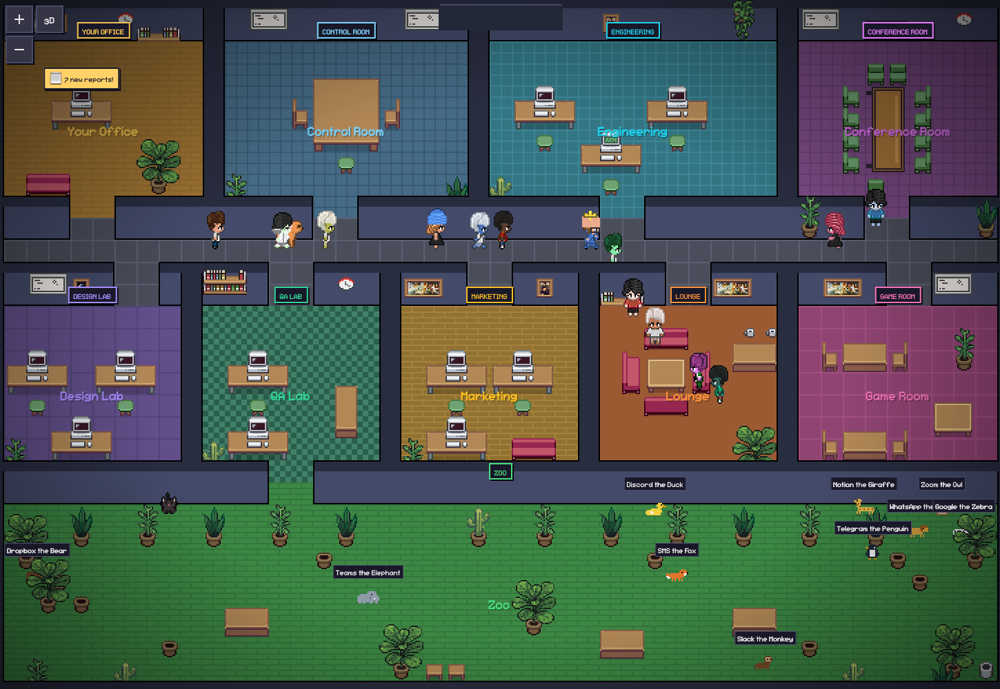
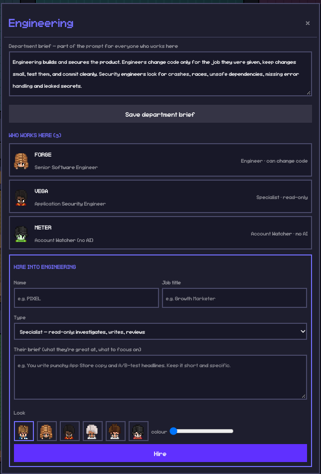
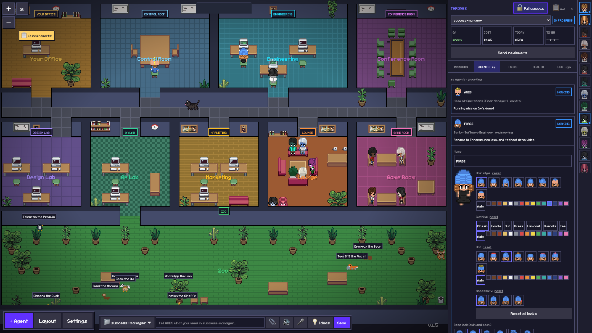
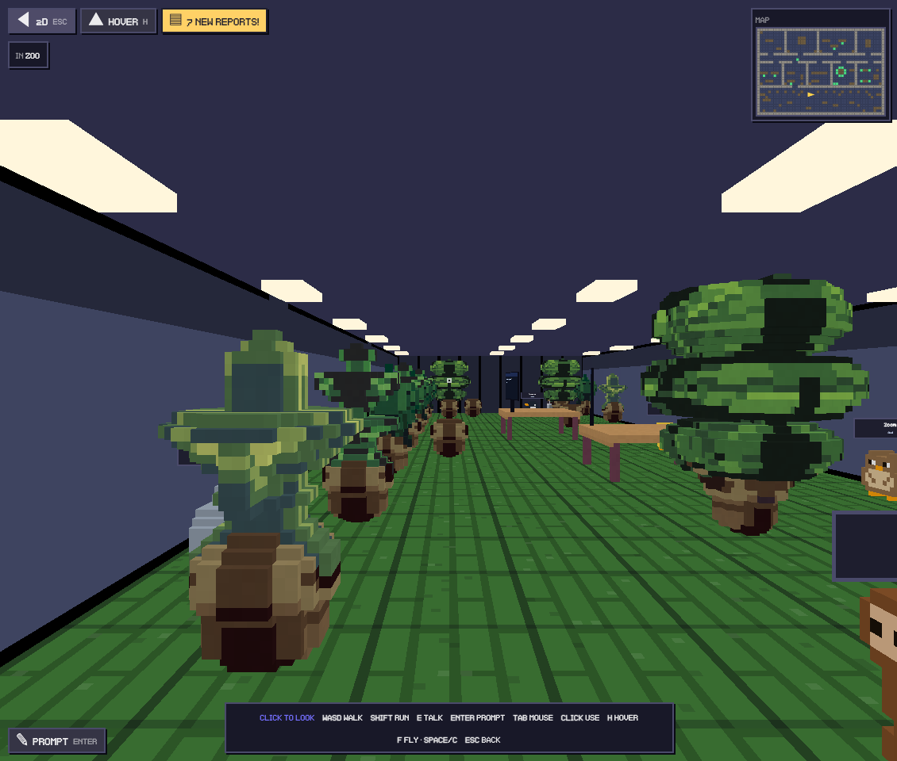
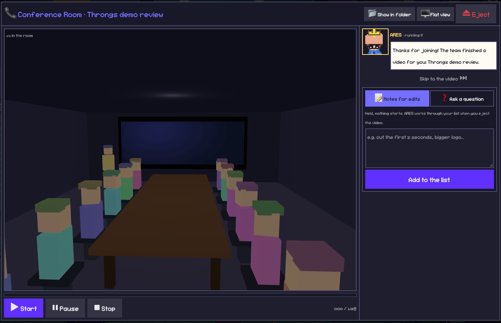
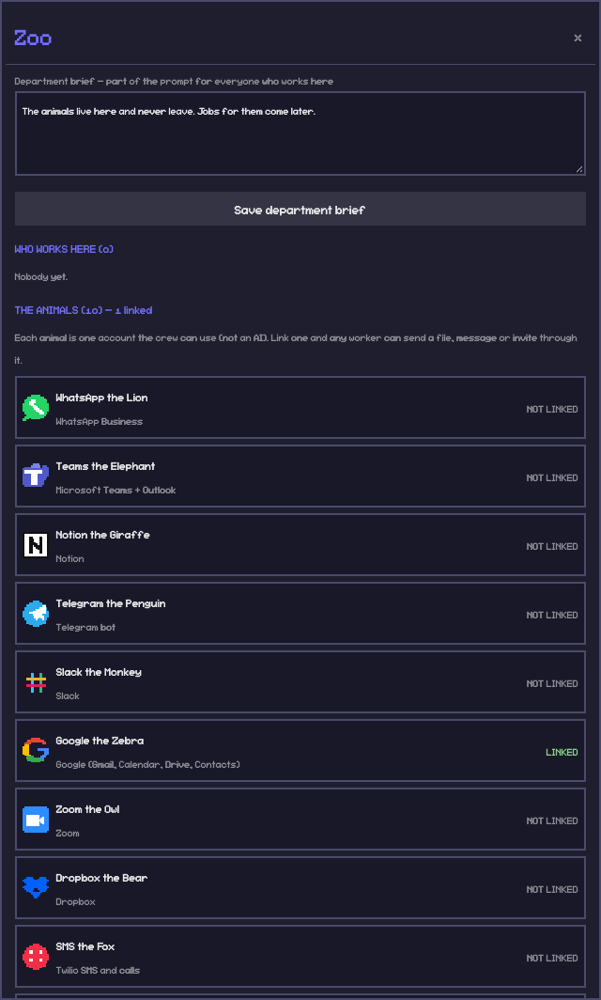
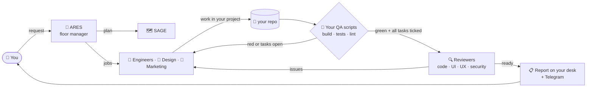

<div align="center">


# Throngs

**A pixel-art office where a crew of Claude Code agents does the work for you.**

You give the floor manager a request. The crew plans it, builds it, tests it and reports back.<br/>
They keep at it until independent QA says it's done, not until the AI thinks it is.

[](LICENSE)


[Quick start](#-quick-start) · [The crew](#-meet-the-crew) · [IVY, your secretary](#-ivy-your-secretary) · [How it works](#-how-it-works) · [Commands](#-command-cheat-sheet)

<br/>



</div>

---

## ✨ What you get

<table>
<tr>
<td width="50%" valign="top">

### 🏢 A live office you can watch
Every agent is a little character at a desk. They walk to their room when they get a job, sit down to work, and head to the lounge when they're done. Click anyone to see what they're doing right now.

</td>
<td width="50%" valign="top">

### ✅ "Done" means really done
A Claude Code hook stops the agent from finishing until **your** QA scripts (build, tests, lint) are green and every task is ticked. A failing report goes straight back into the same session.

</td>
</tr>
<tr>
<td valign="top">

### 🧠 A trained crew, not one chatbot
17 roles across 6 departments, each with its own playbooks: TDD, systematic debugging, security review, UI design, copywriting, video, PDFs and more.

</td>
<td valign="top">

### 📞 A secretary who picks up
IVY answers your phone, reads you your day, sends Meet invites, calls people for you and pings you on Telegram when the crew needs you.

</td>
</tr>
<tr>
<td valign="top">

### 🛡️ Safety rails built in
A guard checks every command the agents run. Nobody pushes, deploys, wipes your uncommitted work or reads your secrets unless you switch it on for that project.

</td>
<td valign="top">

### 🎬 Meetings for finished work
When a video or report is ready, the Conference Room calls you in. ARES walks you through it, and you leave notes for edits right there.

</td>
</tr>
</table>

---

## 🚀 Quick start

> **You need:** macOS (Linux works without the Mac app bits), [Node.js 20+](https://nodejs.org), git, and the [Claude Code CLI](https://docs.anthropic.com/en/docs/claude-code) signed in once.

```bash
npm i -g @anthropic-ai/claude-code && claude      # sign in to Claude Code once

git clone https://github.com/Gabrielleubitz/throngs.git
cd throngs
./install.sh     # checks your machine, installs and builds the office, creates .env
./start.sh       # opens the office; first launch plays a short welcome tour
```

The welcome tour ends with a **setup checklist** for your machine. It shows what's needed to run, what's recommended, and the optional features with what each one unlocks. Anything missing comes with the exact command and a Copy button. The list re-checks itself as you fix things. The same checklist is in the terminal: `node bin/sm.js doctor`.

Then add a project and give the floor manager something to do:

```bash
node bin/sm.js add ~/code/my-app            # QA commands are auto-detected (build, test, lint)
node bin/sm.js manage "Add a dark mode toggle to settings" --project my-app
```

Or just type it into the **Talk to the floor manager** box in the office.

> [!TIP]
> `node bin/sm.js doctor` checks everything and prints the exact fix for anything missing. Add `alias sm="node $(pwd)/bin/sm.js"` to your shell profile to type `sm` instead.

---

## 👥 Meet the crew



| | Who | Job |
|---|---|---|
| 👑 | **ARES** | Floor manager. Turns your request into a plan, hands out jobs, checks the results against the real code |
| 🗺️ | **SAGE** | Mission planner |
| 💡 | **MUSE** | Head of future ideas |
| 🔨 | **FORGE · BOLT · FLUX** | Software engineers who change code |
| 🔐 | **VEGA** | Application security |
| 🎨 | **LYRA · ORION** | UI design and UX research |
| 🧪 | **ATLAS** | QA lead |
| 📣 | **NOVA** | Content and marketing |
| 🎬 | **REEL** | Video producer (Remotion) |
| 📄 | **DECK · FOLIO** | Documents, slides and PDFs |
| 📞 | **IVY** | Your secretary: phone, Telegram, Google |
| 📊 | **METER** | Watches your Claude accounts and switches when one runs out (no AI) |
| 🚨 | **TRACE** | Watches the error log (no AI) |

**Hire your own.** Every department has a hire form: name, job title, a brief and a look. Each department is a Claude Code plugin folder in [`office/departments/`](office/departments), so new hires get that room's playbooks automatically.

<br clear="right"/>

---

## 📞 IVY, your secretary

IVY sits at Reception and is your way into the office when you're away from the screen.

<table>
<tr><td>☎️ <b>Answers your phone</b></td><td>Strangers, deliveries, spam and you. She takes messages, puts urgent callers through and recognizes you (with a PIN from other phones). Twilio, low-latency streaming voice.</td></tr>
<tr><td>📲 <b>Calls people for you</b></td><td><i>"Call Dana and tell her I'm ten minutes late."</i> She reads it back and dials only after you say yes. Then she sends you the outcome.</td></tr>
<tr><td>💬 <b>Lives on Telegram</b></td><td>Finished missions, questions from the crew with one-tap answer buttons, and a <code>/</code> menu. If something is urgent and you don't reply, she calls.</td></tr>
<tr><td>📅 <b>Runs your Google</b></td><td>Calendar in the office, Meet invites and emails. She spells addresses back to you, remembers contacts, and notices when an email bounces. Nothing is sent without your yes.</td></tr>
<tr><td>🌅 <b>Morning brief</b></td><td>Your calendar, what needs you, failing CI and what happened overnight, every morning.</td></tr>
<tr><td>🧑‍💻 <b>Knows your dev day</b></td><td><code>sm pulse</code> scans every local repo and GitHub for failing checks, unpushed and uncommitted work and alerts, so she and the crew know the state of your code.</td></tr>
</table>

All of it is optional. The office works fine without a phone, Telegram or Google. Turn the phone line off any time with `sm phone --off`.

---

## 🖼️ A look around

<table>
<tr>
<td width="50%"><br/><sub><b>Agents.</b> See who is working on what, and customize anyone's look.</sub></td>
<td width="50%"><br/><sub><b>3D mode.</b> Walk the office in first person (WASD) and talk to the crew.</sub></td>
</tr>
<tr>
<td width="50%"><br/><sub><b>Conference Room.</b> Finished videos and reports are presented to you in a meeting.</sub></td>
<td width="50%"><br/><sub><b>The Zoo.</b> Each animal is one account the crew can use: WhatsApp, Slack, Google, Telegram, Notion, Zoom, Dropbox, Twilio and more.</sub></td>
</tr>
</table>

---

## ⚙️ How it works



- **The supervisor** (`bin/sm.js`) installs a Claude Code `Stop` hook in each project. When an agent tries to stop, it runs your QA commands and reads the task list. If something fails, the report goes back into the **same** session and the agent keeps going.
- **The office** (`pixel-office/`) is a fork of [Pixel Agents](https://github.com/pixel-agents-hq/pixel-agents): a Node server plus a React and canvas UI that turns live Claude Code sessions into characters.
- **Missions** (`bin/missions.js`): ARES plans, splits the work across the crew, then reviews and re-runs. Every loop has a hard budget, so nothing runs forever.
- **The guard** (`sm hook guard`) is a `PreToolUse` hook that denies risky commands: pushing, deploying, `git clean`, reading tokens, editing another project.
- **Shared brain** (`lat.md/`): the office documents itself in [lat.md](https://github.com/vercel-labs/lat.md), and every agent reads it before working.

<details>
<summary><b>📁 What's in the repo</b></summary>

```
bin/                 the supervisor, office API, IVY (phone, Telegram, Google), missions, guard
office/departments/  each department is a Claude Code plugin with its playbooks (skills)
office/staff.json    rooms and the default crew
pixel-office/        the office app (Pixel Agents fork: server + React UI + 3D mode)
office-app/          a tiny native macOS wrapper (AI Office.app in your Dock)
office-layout/       the office floor plan
lat.md/              the office's own documentation, read by every agent
agents/              the five reviewer prompts (code, UI, UX, functionality, marketing)
dashboard/           a lightweight web dashboard (task queue, QA, costs, logs)
test/                250+ tests (node --test)
```
</details>

---

## 🔌 Optional extras

Everything below is opt-in. Link services in the office (**Zoo**), or with `sm integration`. Keys stay on your machine in `office/integrations.json`, which git ignores.

| Want | Set up |
|---|---|
| 🔊 Crew voices and narration | Add `ELEVENLABS_API_KEY` to `.env` |
| ☎️ IVY on the phone | Link **SMS the Fox** (Twilio). `cloudflared` gives the office a public address automatically (`brew install cloudflared`) |
| 💬 IVY on Telegram | Create a bot with @BotFather, link **Telegram the Penguin**, then `sm telegram --test --menu` |
| 📅 Calendar, Meet and Gmail | Link **Google the Zebra** |
| 🍎 Mac app in the Dock | `sm app` |
| ☁️ Encrypted backup of your linked keys | `sm firebase link key.json` then `sm firebase push --passphrase "…"` |
| 👥 Several Claude accounts | Install `cswap` (Claude account swapper); METER switches accounts when one runs out |

---

## 🧾 Command cheat sheet

```bash
sm office [--build] [--restart]           # start the office
sm add <path>                             # manage a project (QA auto-detected)
sm manage "<request>" --project <name>    # give ARES a mission
sm status                                 # every project at a glance
sm run <name>                             # audit → build → re-audit until ready
sm audit <name>                           # read-only reviewers file tasks
sm task "<title>" --project <name>        # add work (auto-routed when no project is given)
sm pulse                                  # your dev day across local repos + GitHub
sm today [--send]                         # IVY's morning brief
sm remind "<text>" --at 16:30             # IVY reminds you
sm phone [--on|--off|--pin 1234]          # IVY's phone line
sm telegram [--test|--menu]               # IVY's Telegram line
sm doctor                                 # is this machine ready?
```

Full list: `node bin/sm.js help` · Deep reference: [`docs/reference.md`](docs/reference.md)

---

## 🧪 Development

```bash
node --test test/*.test.js                 # 250+ tests, no network needed
npm --prefix pixel-office run build        # rebuild the office UI
sm office --check                          # test the live office end to end
```

Before changing a part of the office, read its section in [`lat.md/`](lat.md). Contributions are welcome. Keep changes small and tested.

---

## 🙏 Credits

- **[Pixel Agents](https://github.com/pixel-agents-hq/pixel-agents)** by Pablo De Lucca (MIT): the pixel office this is built on.
- Department skills from **[obra/superpowers](https://github.com/obra/superpowers)**, **[anthropics/skills](https://github.com/anthropics/skills)**, **[coreyhaines31/marketingskills](https://github.com/coreyhaines31/marketingskills)**, **[trailofbits/skills](https://github.com/trailofbits/skills)** and **[JuliusBrussee/caveman](https://github.com/JuliusBrussee/caveman)**. See each folder's `SOURCES.md` for the license.
- Anthropic's document skills (`docx`, `pptx`, `xlsx`, `pdf`) are not open source, so they aren't included. To give DECK and FOLIO those abilities, copy them from [anthropics/skills](https://github.com/anthropics/skills) into `office/departments/crew-docs/skills/` and `office/departments/design/skills/`.

<div align="center">
<br/>
<sub>Built by <b>Igani</b> · MIT licensed · Your crew, always at work.</sub>
</div>
